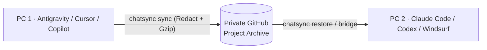

<picture>
  <source media="(prefers-color-scheme: dark)" srcset="./docs/assets/hero-dark.svg" />
  <source media="(prefers-color-scheme: light)" srcset="./docs/assets/hero-light.svg" />
  
</picture>

<div align="center">

[](https://github.com/MahmoudELsawy0357/chatsync/actions/workflows/ci.yml)
[-161B22?style=flat-square)](./src/universal-agents.ts)
[](https://bun.sh/)
[](./tsconfig.json)
[](./plugin/plugin.json)
[](./docs/SECURITY.md)
[](./LICENSE.md)

<samp>
  <a href="#1-line-global-install">1-line install</a> &nbsp;·&nbsp;
  <a href="#mode-1-single-pc-instant-bridge-zero-github">single-pc bridge</a> &nbsp;·&nbsp;
  <a href="#supported-ai-agents">any ai agent</a> &nbsp;·&nbsp;
  <a href="#mode-2-multi-pc-cloud-sync-optional-github">multi-pc sync</a> &nbsp;·&nbsp;
  <a href="#cli-reference">cli reference</a> &nbsp;·&nbsp;
  <a href="./docs/SECURITY.md">security</a>
</samp>

</div>

---

## Overview

**`chatsync` (`v3.0`)** is a universal AI coding session bridge and optional multi-device conversation archiver.

1. **On 1 PC (Zero GitHub Repo Needed):** Hit a token/quota limit in **Cursor** or **Antigravity**? Run `chatsync bridge` (or `chatsync to claude`) inside your project folder and resume the exact conversation in **< 1 second** across **Claude Code**, **OpenAI Codex**, **Cursor**, **Windsurf**, **Cline**, **Roo Code**, **GitHub Copilot**, **Gemini CLI**, **Aider**, or **any AI agent in the world** via `.chatsync/latest.md`.
2. **Across 2+ PCs (Optional Private GitHub Backup):** Link a private GitHub repository once (`chatsync setup`) for lossless binary + Markdown synchronization, automatic secret redaction, and silent background auto-sync across Windows, macOS, and Linux.

---

## 1-Line Global Install

No interactive questions, no per-project config files. Run **one line** once on your machine:

```bash
bunx github:MahmoudELsawy0357/chatsync install
```

What this installs in ~2 seconds:
- Global **`chatsync`** CLI command (`~/.bun/bin/chatsync`) usable from **any folder**.
- Global **`/chatsync`** skill & rules simultaneously across every AI agent installed on your PC (**Google Antigravity**, **Claude Code**, **OpenAI Codex**, **Gemini CLI**, **Windsurf**, and **Cline**).

---

## Mode 1: Single-PC Instant Bridge (Zero GitHub!)

Only working on **one computer** and want to connect your AI agents together without creating any GitHub repo or `sync.config.json`? `cd` into **any** project and run:

```bash
# Link ALL sessions across every AI agent installed on your PC at once:
chatsync bridge

# Or send your project sessions directly to a specific AI agent:
chatsync to claude      # -> Seeds native resumable `claude --resume` history
chatsync to codex       # -> Seeds native Codex CLI & VS Code sidebar threads
chatsync to cursor      # -> Writes git-excluded `.cursor/rules/chatsync-handoff.mdc`
chatsync to windsurf    # -> Writes git-excluded `.windsurf/rules/chatsync-handoff.md`
chatsync to cline       # -> Writes git-excluded `.clinerules/chatsync-handoff.md`
chatsync to universal   # -> Writes `.chatsync/latest.md` + `.chatsync/sessions/*.md` for ANY AI tool!

# Inspect all detected AI agents & live sessions for the current folder:
chatsync status
```

> All local context files (`.chatsync/`, `.cursor/rules/chatsync-handoff.mdc`, `.windsurf/rules/chatsync-handoff.md`, `.clinerules/chatsync-handoff.md`) are automatically added to `.git/info/exclude` so your team's `git status` stays **100% clean**.

---

## Supported AI Agents

| AI Agent | Local Session Discovery | Instant Bridge Target (`chatsync to ...`) | Global `/chatsync` Skill / Rule |
| :--- | :--- | :--- | :--- |
| **Google Antigravity** | `~/.gemini/antigravity` (`SQLite + Protobuf`) | Lossless `.db` restore + `ConversationService` | `~/.gemini/config/plugins/chatsync` |
| **Claude Code** | `~/.claude/projects/<encoded-cwd>/*.jsonl` | Native multi-turn `claude --resume` `.jsonl` | `~/.claude/skills/chatsync/SKILL.md` |
| **OpenAI Codex** | `~/.codex/sessions/**/*.jsonl` + SQLite | Native Codex CLI & VS Code `Chats` threads | `~/.codex/skills/chatsync/SKILL.md` |
| **Cursor** | `Cursor/User/workspaceStorage/*/state.vscdb` | `.cursor/rules/chatsync-handoff.mdc` | `@chatsync-handoff.mdc` |
| **Windsurf** | `Windsurf/User/globalStorage` & Cascade | `.windsurf/rules/chatsync-handoff.md` | `~/.codeium/windsurf/memories/global_rules.md` |
| **GitHub Copilot** | `Code/User/workspaceStorage/*/chatSessions/*.json` | `.chatsync/latest.md` (`#file:.chatsync/latest.md`) | Workspace context |
| **Cline & Roo Code** | `globalStorage/*/tasks/*/ui_messages.json` | `.clinerules/chatsync-handoff.md` (auto-loaded) | `~/Documents/Cline/Rules/chatsync.md` |
| **Gemini CLI** | `~/.gemini/tmp/*/chats/*.json` | `.chatsync/latest.md` | `~/.gemini/skills/chatsync/SKILL.md` |
| **Aider** | `<workspace>/.aider.chat.history.md` | `/read .chatsync/latest.md` | Workspace context |
| **Any Other AI Agent** | Open `.chatsync/sessions/*.md` standard | Universal `.chatsync/latest.md` Markdown bridge | Works in OpenCode, Zed, Devin, Web LLMs & future agents |

---

## Mode 2: Multi-PC Cloud Sync (Optional GitHub)

Working across **2 or more computers** (e.g., Office PC + Home Laptop) or want encrypted-safe private cloud backups?



```bash
# One-time setup to link a private GitHub archive for a project:
chatsync setup

# Daily push & pull (or let `chatsync autostart` run silently in the background):
chatsync sync
chatsync restore
```

### Multi-PC Engine Highlights
- **Antigravity 2.x Protobuf Remapping:** Losslessly rewrites `raw_summary`, `trajectory_metadata_blob`, and `agyhub_summaries_proto.pb` across machines, drives, and OSes.
- **Byte-Preserving Secret Redaction:** Scrubs API keys, tokens, PEM blocks, database URLs, and JWTs using **Same-Byte-Length Binary Replacement + `VACUUM`**, verified across all `.gz` and `.partNN` chunks before any `git push`.
- **Zero Git LFS Needed:** Compresses `140+ MB` SQLite databases down to `~20 MB` and auto-splits chunks above `40 MB`.
- **Silent OS Login Auto-Sync (`chatsync autostart`):** Syncs after 3m idle, every 15m checkpoint, and on IDE exit.

---

## CLI Reference

| Command | Description |
| :--- | :--- |
| `chatsync install` | 1-line zero-prompt install of `chatsync` CLI + global skills across all installed AI agents. |
| `chatsync bridge` | Bridges live sessions across **all** installed AI agents on this PC (zero GitHub needed). |
| `chatsync to <agent>` | Bridges sessions directly to `claude`, `codex`, `cursor`, `windsurf`, `cline`, `roocode`, `copilot`, `gemini`, or `universal`. |
| `chatsync status` | Inspects installed AI agents, local live sessions, and archive sync health (works with or without GitHub). |
| `chatsync setup` | Wizard (or non-interactive flags) to link an optional private GitHub archive for 2+ PCs. |
| `chatsync sync` / `push` | Exports all agents, redacts secrets, verifies zero leaks, and pushes to GitHub. |
| `chatsync restore` / `pull` | Pulls remote archives and restores Antigravity, Claude Code, and Codex sessions (`--wait` supported). |
| `chatsync search "<query>"` | Full-text search across archived transcripts with clickable `conversation://` links. |
| `chatsync autostart` | Installs and starts silent background auto-sync on OS login (`autostart:stop` to remove). |
| `chatsync shortcut` | Creates a smart Desktop launcher icon (`restore` -> launch IDE -> auto-sync). |
| `chatsync verify` | Audits `conversations/`, `antigravity-backup/`, and `agent-backups/` for secret leaks. |
| `chatsync uninstall` | Cleanly removes the global `chatsync` CLI, plugin, and agent skills. |

---

## Documentation & License

- [**Architecture & Multi-Agent Storage Schemas (`docs/ARCHITECTURE.md`)**](./docs/ARCHITECTURE.md)
- [**Security & Secret Redaction Policy (`docs/SECURITY.md`)**](./docs/SECURITY.md)
- [**Automated AI Setup Prompt (`templates/AGENT_BOOTSTRAPER_PROMPT.md`)**](./templates/AGENT_BOOTSTRAPER_PROMPT.md)
- Released under the [**MIT License**](./LICENSE.md).
