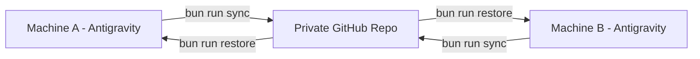

# `antigravity-chat-sync`

**Project-scoped Google Antigravity conversation archiver and multi-device sync toolkit** backed by a private GitHub repository.

Keep all your **Google Antigravity** conversations, plans, and artifacts for a specific project backed up as readable Markdown on GitHub **and** seamlessly synced across multiple computers (e.g., office PC + home laptop) — without mixing unrelated projects, leaking API tokens, or touching the terminal every day.

---

## Features

- **Strict Project Isolation:** Filters `~/.gemini/antigravity` by `workspace_uris` so **only** conversations (and subagents) belonging to your target project are archived.
- **GitHub-Ready Markdown + Artifacts:** Exports clean chronological transcripts and generated plans/walkthroughs, auto-splitting transcripts over `380 KB` into linked parts so GitHub renders every page in full.
- **Smart Multi-Device Additive Merge:** Syncs across any number of machines without overwriting newer local work or deleting conversations created on another machine.
- **Antigravity 2.x Project ID & Cross-Drive Remapping:** Auto-detects (or auto-creates on brand-new machines) `~/.gemini/config/projects/*.json`, losslessly rewrites Protobuf `raw_summary`, `trajectory_metadata_blob`, and `agyhub_summaries_proto.pb`, drops missing foreign workspaces, and adapts `workspace_uris` & cross-user `brain/` artifact links across drives/OSes.
- **In-Place Rebinding, Extras & Renamed Folders (`legacyProjectSlugs`):** Rebinds newer local chats and subagents carrying a foreign `project_id` in-place without downgrading step counts, preserves `annotations/` & `chapter_titles/`, and remaps historical conversations from renamed project folders.
- **SQLite WAL-Safe Sync, `--wait` Restore & `doctor`:** Captures active `-wal`/`-shm` frames with `PRAGMA wal_checkpoint(TRUNCATE)`, cleans orphan split chunks, supports `bun run restore --wait` (auto-finalizes the instant Antigravity closes), and provides `bun run status` / `bun run doctor` health diagnostics.
- **Protobuf-Safe Secret Redaction & Multi-Part Audit:** Scrubs Jira, Postman (`PMAK-...`), GitHub, Google, Slack, Stripe, OpenAI/Anthropic, AWS, Private Keys, DB URLs with passwords, and JWTs using **Same-Byte-Length Redaction + `VACUUM`**, and `bun run verify` reassembles & scans multi-part `.gz.partNN` archives before push.
- **Zero Git LFS Required:** Compresses `140+ MB` SQLite databases down to `~20 MB` via `Bun.gzipSync` and auto-chunks archives above `40 MB`.
- **Silent OS Startup Auto-Sync Daemon (`bun run autostart`) + 1-Click Launcher (`bun run shortcut`):** Runs silently in the background on Windows/macOS/Linux login (0 console flash, immune to `Reload Window` / `Server Restart`) — auto-restores on boot while Antigravity is closed, and auto-syncs after **3 min idle**, every **15 min of active work**, and on **exit** regardless of how you open Antigravity!
- **Zero-Terminal Playbooks:** Also includes drop-in Antigravity agent playbooks (`CHATS_SYNC.md` & `SETUP_SECOND_PC.md`) hidden via `.git/info/exclude` so your team code repo stays 100% clean.

---

## How Multi-Device Sync Works



---

## Quick Start

### Prerequisites
- [Bun](https://bun.sh/) (`>= 1.1`)
- [GitHub CLI (`gh`)](https://cli.github.com/) authenticated with your personal GitHub account (`gh auth status`)

### Option A: Automated Setup via Antigravity AI (Recommended — 60 Seconds)
Open [`templates/AGENT_BOOTSTRAPER_PROMPT.md`](./templates/AGENT_BOOTSTRAPER_PROMPT.md), copy the prompt into **Google Antigravity** inside your target project, replace your GitHub username + desired private repo name, and let the agent configure and push everything automatically!

### Option B: Manual CLI Setup

```bash
# 1. Clone this toolkit into a new folder for your project's chat archive
git clone https://github.com/MahmoudELsawy0357/antigravity-chat-sync.git my-project-chats
cd my-project-chats
rm -rf .git && git init -b main

# 2. Initialize config & install local agent playbooks into your project
bun run init \
  --project "my-project-folder-name" \
  --repo "your-github-username/my-project-chats" \
  --workspace "/full/path/to/my-project-folder-name"

# 3. Export conversations locally & verify zero secret leaks
bun run sync --no-push
bun run verify

# 4. Create the private GitHub repository and push
git add -A && git commit -m "feat: initial project conversation archive"
gh repo create your-github-username/my-project-chats --private --source=. --remote=origin --push
```

---

## Daily Workflow (Across Any Number of Machines)

### 1. First Time on a Second Machine
Send the generated `SETUP_SECOND_PC.md` file to Antigravity on the second machine — or run manually:
```bash
# Close Antigravity completely first so language_server doesn't overwrite agyhub_summaries_proto.pb from RAM
git clone https://github.com/your-github-username/my-project-chats.git
cd my-project-chats
bun run restore --workspace "/path/to/my-project-on-second-pc"
```
Then open Antigravity — all conversations will appear cleanly bound to your local project!

### 2. Everyday Syncing (Directly Inside Antigravity Chat)
`bun run init` installs `CHATS_SYNC.md` into your project root and adds it to `.git/info/exclude` (never polluting your team's `.gitignore` or `git status`):
- **After finishing work on a machine:** Tag `@CHATS_SYNC.md` and type: *"Push/sync chats"*.
- **When switching to another machine:** Tag `@CHATS_SYNC.md` and type: *"Pull/restore chats"* — or (recommended for Antigravity 2.x) close Antigravity completely (`File -> Exit`), run `cd my-project-chats && bun run restore`, and reopen Antigravity so `language_server` loads the freshly rebound `agyhub_summaries_proto.pb`.

---

## Configuration & CLI Flags

`sync.config.json`:

| Field | Description |
|---|---|
| `projectSlug` | Target project folder name used to isolate conversations (e.g. `my-app`). |
| `projectDisplayName` | Friendly display name for `ARCHIVE_INDEX.md`. |
| `legacyProjectSlugs` | Optional array of previous folder names (e.g. `["old-template-name"]`) to include and remap to `projectSlug`. |
| `archiveRepo` | Private GitHub repo (`username/my-app-chats`). |
| `maxChunkMB` | Max `.gz` chunk size (default `40` MB, well under GitHub's limit). |
| `maxMarkdownPartKB` | Auto-split Markdown threshold (default `380` KB). |
| `extraConversationIds` | Optional extra conversation UUIDs to force-include. |
| `excludedConversationIds` | Conversation UUIDs to always skip (e.g. setup/sync utility chats). |

Useful CLI commands & flags:
- `bun run autostart` — Installs and starts a silent OS login background daemon (Windows Startup `.vbs` / macOS `LaunchAgent` / Linux `autostart`) so auto-restore on boot & 3m-idle / 15m-checkpoint / exit auto-sync work automatically even when opening Antigravity from its normal icon!
- `bun run autostart:stop` — Stops the background daemon and removes the OS login entry.
- `bun run shortcut` — Creates a 1-click Desktop icon (`<Project> (Antigravity)`) that auto-restores on launch and auto-syncs on exit.
- `bun run launch` — Runs the reload-proof auto-restore -> launch Antigravity -> auto-sync-on-close lifecycle directly.
- `bun run status` / `bun run doctor` — Read-only sync & project health dashboard (local vs archive step counts, foreign `project_id` detection, `language_server` status).
- `bun run restore --wait` — Unpacks archives immediately, waits for you to quit Antigravity, then persists all Protobuf/SQLite indexes with zero race condition.
- `bun run restore --workspace "/path/to/project"` — Explicitly set the target workspace path on this machine.
- `bun run restore --index-only` — Fast re-sync of `conversation_summaries.db` and `agyhub_summaries_proto.pb` without unpacking `.db`/brain archives.
- `bun run sync --exclude "<conv-id>"` — Exclude the current utility chat during push.
- `bun run sync --no-push` — Export and sanitize locally without committing or pushing.
- `bun run verify` — Audits all Markdown, `.gz`, and multi-part `.gz.partNN` archives for secret leaks & file-size limits.
- `bun test` — Runs automated unit tests for Protobuf remapping, secret redaction, and multi-part archive verification.

---

## Repository Structure

```text
antigravity-chat-sync/
├── src/
│   ├── config.ts              # Config loader & CLI flag parser
│   ├── init.ts                # Project initializer & playbook installer (.git/info/exclude)
│   ├── protobuf.ts            # Lossless Antigravity 2.x Protobuf & project_id/agyhub remapper
│   ├── redact.ts              # Text redactor + Same-Byte-Length SQLite Protobuf sanitizer + VACUUM
│   ├── markdown-exporter.ts   # JSONL & FTS byte-offset Markdown builder (<380 KB auto-pagination)
│   ├── sync.ts                # Smart additive push (actual DB steps + WAL checkpoint + orphan chunk cleanup + extras)
│   ├── restore.ts             # Non-destructive pull + --wait + auto project config + cross-user brain link rewrite
│   ├── status.ts              # Read-only sync & Antigravity 2.x project health doctor (`bun run status`)
│   └── verify.ts              # File-size & gunzipped (single + multi-part .partNN) secret-leak auditor
├── tests/
│   ├── protobuf.test.ts       # Unit tests for lossless Protobuf & agyhub/project_id remapping
│   ├── redact.test.ts         # Unit tests for secret rules, same-length binary redaction & VACUUM
│   └── verify-chunks.test.ts  # Unit tests for multi-part .gz.partNN secret leak detection
├── templates/
│   ├── AGENT_BOOTSTRAPER_PROMPT.md  # Copy-paste prompt for 1-click AI setup
│   ├── CHATS_SYNC.template.md       # Daily chat-driven sync playbook template
│   └── SETUP_SECOND_PC.template.md  # Second-PC bootstrapper playbook template
├── docs/
│   ├── ARCHITECTURE.md        # Deep dive into Antigravity's SQLite & FTS5 schema
│   └── SECURITY.md            # How Protobuf-safe binary token redaction works
└── sync.config.example.json   # Example project configuration
```

---

## Deep-Dive Documentation

- [**Architecture & SQLite Schema (`docs/ARCHITECTURE.md`)**](./docs/ARCHITECTURE.md)
- [**Security & Binary Protobuf Redaction (`docs/SECURITY.md`)**](./docs/SECURITY.md)
- [**1-Click AI Setup Prompt (`templates/AGENT_BOOTSTRAPER_PROMPT.md`)**](./templates/AGENT_BOOTSTRAPER_PROMPT.md)
