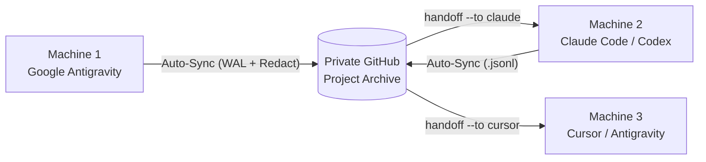

<picture>
  <source media="(prefers-color-scheme: dark)" srcset="./docs/assets/hero-dark.svg" />
  <source media="(prefers-color-scheme: light)" srcset="./docs/assets/hero-light.svg" />
  
</picture>

<div align="center">

[](https://github.com/MahmoudELsawy0357/antigravity-chat-sync/actions/workflows/ci.yml)
[](./src/agents.ts)
[](https://bun.sh/)
[](./tsconfig.json)
[](./plugin/plugin.json)
[](./docs/SECURITY.md)
[](./LICENSE.md)

<samp>
  <a href="#supported-ai-agents">agents</a> &nbsp;·&nbsp;
  <a href="#core-capabilities">capabilities</a> &nbsp;·&nbsp;
  <a href="#cross-agent-session-handoff">handoff</a> &nbsp;·&nbsp;
  <a href="#quick-start">quick start</a> &nbsp;·&nbsp;
  <a href="#configuration--cli-reference">cli reference</a> &nbsp;·&nbsp;
  <a href="./docs/SECURITY.md">security</a>
</samp>

</div>

---

## Overview

`antigravity-chat-sync` (`v2.0`) is a project-scoped AI session archiver, multi-device synchronization engine, and **cross-agent session handoff bridge** across **Google Antigravity**, **Claude Code**, **OpenAI Codex**, and **Cursor**.

Start a feature in **Antigravity** at the office, continue the exact session in **Claude Code** or **Codex** on your laptop, and review or iterate in **Cursor** on a third machine — backed by one secret-redacted private GitHub archive per project.

---

## Supported AI Agents

| Agent | Local Storage Discovery | Same-Agent Multi-PC Restore | Cross-Agent Handoff (`--to`) | Global `/chat-sync` Skill |
| :--- | :--- | :---: | :---: | :---: |
| **Google Antigravity** | `~/.gemini/antigravity` (`SQLite + Protobuf`) | Lossless `.db` + `project_id` remap | Spawns live chat via `ConversationService` | `~/.gemini/config/plugins/` |
| **Claude Code** | `~/.claude/projects/<encoded-cwd>/*.jsonl` | Lossless `.jsonl` + `cwd` remap | Seeds resumable `claude --resume <id>` session | `~/.claude/skills/chat-sync/` |
| **OpenAI Codex** | `~/.codex/sessions/**/*.jsonl` + `session_index.jsonl` | Lossless `.jsonl` + `session_index` upsert | Seeds resumable thread in Codex CLI & VS Code | `~/.codex/skills/chat-sync/` |
| **Cursor** | `Cursor/User/workspaceStorage/*/state.vscdb` | Unified Markdown & JSON archive | Generates `.cursor/rules/chat-sync-handoff.mdc` | `.cursor/rules/` (git-excluded) |

---

## Core Capabilities

| Capability | Details |
| :--- | :--- |
| **Cross-Agent Session Handoff** | Converts the latest conversation from any agent into a native resumable session in **Claude Code**, **Codex**, **Antigravity**, or **Cursor** via `bun run handoff --to <agent>`. |
| **Unified Multi-Agent Archive** | Collects sessions from all 4 coding agents strictly filtered by `projectSlug`, merging them into one chronological `ARCHIVE_INDEX.md` with per-agent badges. |
| **Universal `/chat-sync` Skill** | One `bun run plugin:install` command installs `/chat-sync` simultaneously into **Antigravity**, **Claude Code**, and **Codex** with zero files added to your project repo. |
| **One-Line `bunx` Interactive Setup** | Auto-discovers local workspaces across shells (including PowerShell, macOS/Linux, and Windows Git Bash `MINGW64`), creates your private GitHub repo, and enables auto-sync. |
| **Antigravity 2.x Protobuf Remapping** | Losslessly rewrites `raw_summary`, `trajectory_metadata_blob`, and `agyhub_summaries_proto.pb`, adapting `workspace_uris` and `project_id` across drives and OSes. |
| **Protobuf-Safe Secret Redaction** | Scrubs API keys, tokens, PEM blocks, database URLs, and JWTs using **Same-Byte-Length Binary Replacement + `VACUUM`**, verified across all `.gz` and `.partNN` chunks before push. |
| **Zero Git LFS Dependency** | Compresses `140+ MB` SQLite databases down to `~20 MB` via `Bun.gzipSync` and splits archives above `40 MB` automatically. |
| **Silent Background Auto-Sync** | Runs invisibly on OS login (`bun run autostart`) — watches local step changes across **Antigravity, Claude Code, Codex, and Cursor** (3m idle / 15m checkpoint / exit sync). |

---

## Cross-Agent Session Handoff



Switch coding agents across machines (or on the same machine) without losing architectural context:

```bash
# Resume the latest project session (from any agent) natively inside Claude Code:
bunx github:MahmoudELsawy0357/antigravity-chat-sync handoff --to claude --project my-app
# -> Outputs: claude --resume <new-session-uuid>

# Resume the latest project session natively inside OpenAI Codex (CLI & VS Code sidebar):
bunx github:MahmoudELsawy0357/antigravity-chat-sync handoff --to codex --project my-app
# -> Outputs: codex resume <new-session-uuid>

# Inject the latest session context into Cursor Composer (hidden via .git/info/exclude):
bunx github:MahmoudELsawy0357/antigravity-chat-sync handoff --to cursor --project my-app

# Spawn a clean continuation chat directly inside Google Antigravity:
bunx github:MahmoudELsawy0357/antigravity-chat-sync handoff --to antigravity --project my-app
```

---

## Quick Start

### Prerequisites

- **[Bun](https://bun.sh/)** `>= 1.1.0`
- **[GitHub CLI (`gh`)](https://cli.github.com/)** authenticated with your GitHub account (`gh auth status`)

### Option A — One-Line Interactive Wizard (`bunx` — Recommended)

```bash
bunx github:MahmoudELsawy0357/antigravity-chat-sync setup
```

Detects local workspaces, creates the sibling archive directory, installs the `/chat-sync` skill across your installed AI agents, verifies zero secret leaks, creates your private GitHub repository, and activates silent OS login auto-sync.

### Option B — Manual CLI Setup

```bash
# 1. Clone this toolkit into a dedicated archive folder next to your project
git clone https://github.com/MahmoudELsawy0357/antigravity-chat-sync.git my-project-chats
cd my-project-chats
rm -rf .git && git init -b main

# 2. Initialize configuration and install /chat-sync across installed AI agents
bun run init \
  --project "my-project-folder-name" \
  --repo "your-github-username/my-project-chats" \
  --workspace "/full/path/to/my-project-folder-name"
bun run plugin:install

# 3. Export sessions locally and audit for secret leaks
bun run sync --no-push
bun run verify

# 4. Create your private GitHub archive repository and push
git add -A && git commit -m "feat: initial project conversation archive"
gh repo create your-github-username/my-project-chats --private --source=. --remote=origin --push

# 5. Enable silent background auto-sync on OS login
bun run autostart
```

---

## Daily Workflow

### 1. Zero-Touch Background Mode

Once `bun run autostart` is enabled on each machine, the background watcher monitors local conversation activity across **Antigravity, Claude Code, Codex, and Cursor**:

| Trigger | Behavior |
| :--- | :--- |
| **OS Login / Boot** | Automatically pulls and restores newer remote conversations while Antigravity is closed. |
| **3 Minutes Idle** | Pushes new local steps from any supported agent after 3 minutes of inactivity. |
| **15-Minute Checkpoint** | Saves and pushes progress every 15 minutes during continuous coding sessions. |
| **Application Exit** | Flushes and pushes final session updates as soon as Antigravity closes. |

### 2. `/chat-sync` Commands (Antigravity, Claude Code & Codex)

| Prompt | Action |
| :--- | :--- |
| `/chat-sync sync chats` | Exports, sanitizes, verifies, and pushes project sessions from all installed agents. |
| `/chat-sync restore chats` | Pulls and restores newer sessions into Antigravity, Claude Code, and Codex. |
| `/chat-sync continue` | Loads the newest session context from another agent/machine to continue seamlessly. |
| `/chat-sync check status` | Displays installed agents, daemon PID, and per-session sync status across all 4 tools. |
| `/chat-sync search <keyword>` | Searches archived transcripts across all agents and outputs clickable links. |

> [!IMPORTANT]
> **Antigravity 2.x In-Memory Index Cache:** While Antigravity is open, `language_server` caches `agyhub_summaries_proto.pb` in memory. Close Antigravity completely (`File -> Exit`) before running `bun run restore`, or run `bun run restore --wait` while open so sidebar index updates persist automatically the moment Antigravity exits.

---

## Configuration & CLI Reference

### `sync.config.json`

| Field | Default | Description |
| :--- | :---: | :--- |
| `projectSlug` | *Required* | Target project directory name used to isolate conversations (e.g., `my-app`). |
| `projectDisplayName` | `projectSlug` | Human-readable project title displayed in `ARCHIVE_INDEX.md`. |
| `legacyProjectSlugs` | `[]` | Previous project folder names to match and remap cleanly to `projectSlug`. |
| `archiveRepo` | *Required* | Target private GitHub repository (`username/my-app-chats`). |
| `maxChunkMB` | `40` | Maximum `.gz` file size in MB before splitting into `.partNN` chunks. |
| `maxMarkdownPartKB` | `380` | Maximum Markdown transcript size in KB before splitting into linked pages. |
| `extraConversationIds` | `[]` | Specific conversation UUIDs to force-include regardless of workspace path. |
| `excludedConversationIds` | `[]` | Conversation UUIDs to permanently skip (e.g., sync utility chats). |

### CLI Commands

| Command | Description |
| :--- | :--- |
| `bun run setup` | Launches the interactive project discovery and archive provisioning wizard. |
| `bun run plugin:install` | Installs `/chat-sync` globally across Antigravity, Claude Code, and Codex. |
| `bun run plugin:uninstall` | Removes the global `/chat-sync` plugin and skills from this machine. |
| `bun run sync` | Pulls remote changes, exports all 4 agents, sanitizes secrets, verifies, and pushes. |
| `bun run restore` | Pulls remote archives and restores Antigravity, Claude Code, and Codex sessions. |
| `bun run restore --wait` | Unpacks archives immediately and writes Antigravity index files on exit. |
| `bun run handoff --to <agent>` | Seeds a resumable continuation session in `claude`, `codex`, `cursor`, or `antigravity`. |
| `bun run search "<keyword>"` | Searches archived transcripts across all agents and outputs `conversation://` links. |
| `bun run status` / `bun run doctor` | Displays multi-agent diagnostics comparing local vs. archived session step counts. |
| `bun run autostart` | Installs and starts the silent OS login background auto-sync daemon. |
| `bun run autostart:stop` | Stops the background daemon and removes the OS login startup entry. |
| `bun run verify` | Audits `conversations/`, `antigravity-backup/`, and `agent-backups/` for secret leaks. |
| `bun test` | Executes the automated unit test suite across all 4 agent adapters and security rules. |

---

## Repository Structure

```text
antigravity-chat-sync/
├── .github/workflows/
│   └── ci.yml                       # Automated strict TS typecheck & unit test pipeline
├── plugin/                          # Native Antigravity plugin & universal SKILL.md bundle
│   ├── plugin.json                  # Plugin manifest & starter prompts
│   ├── assets/logo.svg              # Blueprint identity mark
│   ├── README.md                    # In-app Customizations UI overview
│   └── skills/chat-sync/SKILL.md    # Shared skill installed into Antigravity, Claude & Codex
├── src/
│   ├── cli.ts                       # Unified CLI router (`bunx` entrypoint)
│   ├── agents.ts                    # Claude Code, Codex & Cursor adapters + session seeders
│   ├── handoff.ts                   # Cross-agent session handoff & context bridge
│   ├── bootstrap.ts                 # Cross-shell interactive setup wizard (incl. MINGW64)
│   ├── plugin-install.ts            # Multi-agent global plugin & skill installer
│   ├── registry.ts                  # Machine-local project archive registry
│   ├── search.ts                    # Full-text archive search
│   ├── sync.ts                      # Multi-agent additive push engine + unified index
│   ├── restore.ts                   # Non-destructive multi-agent pull & path remapper
│   ├── daemon.ts                    # Silent multi-agent background watcher
│   ├── autostart.ts                 # Cross-platform OS login installer
│   ├── protobuf.ts                  # Lossless Antigravity 2.x Protobuf & project_id remapper
│   ├── redact.ts                    # Same-byte-length binary Protobuf & text secret sanitizer
│   ├── markdown-exporter.ts         # Antigravity JSONL & FTS5 Markdown builder
│   ├── status.ts                    # Multi-agent sync & health diagnostics
│   └── verify.ts                    # Single & multi-part (.partNN) gunzip secret-leak auditor
├── tests/
│   ├── protobuf.test.ts             # Lossless Protobuf & project_id remapping tests
│   ├── redact.test.ts               # Secret detection, byte-length preservation & VACUUM tests
│   ├── verify-chunks.test.ts        # Multi-part archive reassembly & leak-audit tests
│   ├── search-and-plugin.test.ts    # Search, project registry & plugin manifest spec tests
│   └── multi-agent-handoff.test.ts  # Claude, Codex & Cursor adapters + cross-agent handoff tests
├── docs/
│   ├── ARCHITECTURE.md              # Storage schemas across Antigravity, Claude, Codex & Cursor
│   └── SECURITY.md                  # Threat model & binary Protobuf secret redaction design
├── sync.config.example.json
└── LICENSE.md
```

---

## Documentation & License

- [**Architecture & Multi-Agent Storage Schemas (`docs/ARCHITECTURE.md`)**](./docs/ARCHITECTURE.md)
- [**Security & Secret Redaction Policy (`docs/SECURITY.md`)**](./docs/SECURITY.md)
- [**Automated AI Setup Prompt (`templates/AGENT_BOOTSTRAPER_PROMPT.md`)**](./templates/AGENT_BOOTSTRAPER_PROMPT.md)
- Released under the [**MIT License**](./LICENSE.md).
