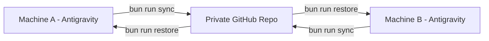

# 💬 `antigravity-chat-sync`

**Project-scoped Google Antigravity conversation archiver and multi-device sync toolkit** backed by a private GitHub repository.

Keep all your **Google Antigravity** conversations, plans, and artifacts for a specific project backed up as readable Markdown on GitHub **and** seamlessly synced across multiple computers (e.g., office PC + home laptop) — without mixing unrelated projects, leaking API tokens, or touching the terminal every day.

---

## ✨ Features

- 🎯 **Strict Project Isolation:** Filters `~/.gemini/antigravity` by `workspace_uris` so **only** conversations (and subagents) belonging to your target project are archived.
- 📖 **GitHub-Ready Markdown + Artifacts:** Exports clean chronological transcripts and generated plans/walkthroughs, auto-splitting transcripts over `380 KB` into linked parts so GitHub renders every page in full.
- 🔁 **Smart Multi-Device Additive Merge:** Syncs across any number of machines without overwriting newer local work or deleting conversations created on another machine.
- 🗺️ **Antigravity 2.x Project ID & Cross-Drive Remapping:** Auto-detects each machine's local `~/.gemini/config/projects/*.json` `project_id`, losslessly rewrites Protobuf `raw_summary`, `trajectory_metadata_blob`, and `agyhub_summaries_proto.pb`, drops missing foreign workspaces, and adapts `workspace_uris` across drives/OSes (`D:\projects\app` <-> `C:\dev\app` <-> macOS/Linux).
- 🔒 **Protobuf-Safe Secret Redaction:** Scrubs Jira (`ATATT3x...`), Postman (`PMAK-...`), GitHub (`ghp_...`, `github_pat_...`), Google (`AIza...`), Slack, AWS, and OpenAI/Anthropic tokens from both Markdown and binary SQLite Protobuf blobs using **Same-Byte-Length Redaction + `VACUUM`**.
- 📦 **Zero Git LFS Required:** Compresses `140+ MB` SQLite databases down to `~20 MB` via `Bun.gzipSync` and auto-chunks archives above `40 MB`.
- 🤖 **Zero-Terminal Daily Workflow:** Includes drop-in Antigravity agent playbooks (`CHATS_SYNC.md` & `SETUP_SECOND_PC.md`) hidden via `.git/info/exclude` so your team code repo stays 100% clean.

---

## 🔄 How Multi-Device Sync Works



---

## 🚀 Quick Start

### Prerequisites
- [Bun](https://bun.sh/) (`>= 1.1`)
- [GitHub CLI (`gh`)](https://cli.github.com/) authenticated with your personal GitHub account (`gh auth status`)

### Option A: Automated Setup via Antigravity AI (Recommended — 60 Seconds)
Open [`templates/AGENT_BOOTSTRAPER_PROMPT.md`](./templates/AGENT_BOOTSTRAPER_PROMPT.md), copy the prompt into **Google Antigravity** inside your target project, replace your GitHub username + desired private repo name, and let the agent configure and push everything automatically!

### Option B: Manual CLI Setup

```bash
# 1. Clone this toolkit into a new folder for your project's chat archive
git clone https://github.com/MahmoudELsawy0357/antigravity-chat-sync.git my-project-chats
cd my-project-chats
rm -rf .git && git init -b main

# 2. Initialize config & install local agent playbooks into your project
bun run init \
  --project "my-project-folder-name" \
  --repo "your-github-username/my-project-chats" \
  --workspace "/full/path/to/my-project-folder-name"

# 3. Export conversations locally & verify zero secret leaks
bun run sync --no-push
bun run verify

# 4. Create the private GitHub repository and push
git add -A && git commit -m "feat: initial project conversation archive"
gh repo create your-github-username/my-project-chats --private --source=. --remote=origin --push
```

---

## ⚡ Daily Workflow (Across Any Number of Machines)

### 1. First Time on a Second Machine
Send the generated `SETUP_SECOND_PC.md` file to Antigravity on the second machine — or run manually:
```bash
# Close Antigravity completely first so language_server doesn't overwrite agyhub_summaries_proto.pb from RAM
git clone https://github.com/your-github-username/my-project-chats.git
cd my-project-chats
bun run restore --workspace "/path/to/my-project-on-second-pc"
```
Then open Antigravity — all conversations will appear cleanly bound to your local project!

### 2. Everyday Syncing (Directly Inside Antigravity Chat)
`bun run init` installs `CHATS_SYNC.md` into your project root and adds it to `.git/info/exclude` (never polluting your team's `.gitignore` or `git status`):
- **After finishing work on a machine:** Tag `@CHATS_SYNC.md` and type: *"Push/sync chats"*.
- **When switching to another machine:** Tag `@CHATS_SYNC.md` and type: *"Pull/restore chats"*, then reload the window.

---

## 📂 Repository Structure

```text
antigravity-chat-sync/
├── src/
│   ├── config.ts              # Config loader & CLI flag parser
│   ├── init.ts                # Project initializer & playbook installer (.git/info/exclude)
│   ├── protobuf.ts            # Lossless Antigravity 2.x Protobuf & project_id/agyhub remapper
│   ├── redact.ts              # Text redactor + Same-Byte-Length SQLite Protobuf sanitizer + VACUUM
│   ├── markdown-exporter.ts   # JSONL & FTS byte-offset Markdown builder (<380 KB auto-pagination)
│   ├── sync.ts                # Smart additive push (delta step_count check + WAL checkpoint + gzip chunker)
│   ├── restore.ts             # Non-destructive pull + Antigravity 2.x .db/project_id/agyhub remapper
│   └── verify.ts              # File-size & gunzipped secret-leak auditor
├── templates/
│   ├── AGENT_BOOTSTRAPER_PROMPT.md  # Copy-paste prompt for 1-click AI setup
│   ├── CHATS_SYNC.template.md       # Daily chat-driven sync playbook template
│   └── SETUP_SECOND_PC.template.md  # Second-PC bootstrapper playbook template
├── docs/
│   ├── ARCHITECTURE.md        # Deep dive into Antigravity's SQLite & FTS5 schema
│   └── SECURITY.md            # How Protobuf-safe binary token redaction works
└── sync.config.example.json   # Example project configuration
```

---

## 📚 Deep-Dive Documentation

- [**Architecture & SQLite Schema (`docs/ARCHITECTURE.md`)**](./docs/ARCHITECTURE.md)
- [**Security & Binary Protobuf Redaction (`docs/SECURITY.md`)**](./docs/SECURITY.md)
- [**1-Click AI Setup Prompt (`templates/AGENT_BOOTSTRAPER_PROMPT.md`)**](./templates/AGENT_BOOTSTRAPER_PROMPT.md)
