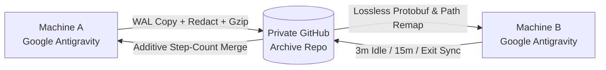

<div align="center">

# antigravity-chat-sync

**Project-scoped Google Antigravity conversation archiver and multi-device sync toolkit.**

[](https://bun.sh/)
[](./tsconfig.json)
[](./docs/ARCHITECTURE.md)
[](#core-capabilities)
[](./docs/SECURITY.md)
[](./LICENSE.md)

[Core Capabilities](#core-capabilities) · [How It Works](#how-multi-device-sync-works) · [Quick Start](#quick-start) · [Daily Workflow](#daily-workflow) · [CLI Reference](#configuration--cli-reference) · [Security](./docs/SECURITY.md)

</div>

---

## Overview

`antigravity-chat-sync` keeps all **Google Antigravity** conversations, implementation plans, and artifacts for a single project backed up as readable Markdown in a private GitHub repository and synchronized across multiple machines (for example, an office workstation and a home laptop) — without mixing unrelated workspaces, leaking credentials, or requiring manual daily terminal commands.

---

## Core Capabilities

| Capability | Details |
| :--- | :--- |
| **Strict Project Isolation** | Filters `~/.gemini/antigravity` by `workspace_uris` so only conversations and child subagents belonging to your target project are archived. |
| **GitHub-Ready Markdown** | Exports chronological transcripts alongside generated plans and walkthroughs, automatically paginating files over `380 KB` into linked parts for full GitHub rendering. |
| **Additive Multi-Device Merge** | Synchronizes across any number of machines without overwriting newer local steps or deleting conversations created on other devices. |
| **Antigravity 2.x Remapping** | Auto-detects or initializes `~/.gemini/config/projects/*.json`, losslessly rewrites Protobuf `raw_summary`, `trajectory_metadata_blob`, and `agyhub_summaries_proto.pb`, and adapts `workspace_uris` across drives and OSes. |
| **In-Place Rebinding & Legacy Slugs** | Rebinds newer local chats carrying a foreign `project_id` without downgrading step counts, preserves `annotations/` and `chapter_titles/`, and remaps renamed folders via `legacyProjectSlugs`. |
| **WAL-Safe SQLite Handling** | Captures active `-wal` and `-shm` frames via `PRAGMA wal_checkpoint(TRUNCATE)` on isolated staging copies, cleans orphan chunks, and supports race-free `bun run restore --wait`. |
| **Protobuf-Safe Secret Redaction** | Scrubs API keys, tokens, PEM blocks, database URLs, and JWTs using **Same-Byte-Length Binary Replacement + `VACUUM`**, audited pre-push by `bun run verify`. |
| **Zero Git LFS Dependency** | Compresses `140+ MB` SQLite trajectories down to `~20 MB` via `Bun.gzipSync` and automatically splits archives exceeding `40 MB` into `.gz.partNN` chunks. |
| **Silent Background Auto-Sync** | Runs invisibly on OS login (`bun run autostart`) with zero console flashes — auto-restores on boot and auto-syncs after **3m idle**, every **15m of active work**, and on **Antigravity exit**. |
| **Zero-Footprint AI Playbooks** | Generates `CHATS_SYNC.md` and `SETUP_SECOND_PC.md` hidden via `.git/info/exclude` so your team code repository remains completely untouched. |

---

## How Multi-Device Sync Works



---

## Quick Start

### Prerequisites

- **[Bun](https://bun.sh/)** `>= 1.1.0`
- **[GitHub CLI (`gh`)](https://cli.github.com/)** authenticated with your GitHub account (`gh auth status`)

### Option A — Automated AI Setup (60 Seconds)

> [!TIP]
> Open [`templates/AGENT_BOOTSTRAPER_PROMPT.md`](./templates/AGENT_BOOTSTRAPER_PROMPT.md), paste the prompt into **Google Antigravity** inside your target project, set your GitHub username and private archive repo name, and let the agent configure, verify, and push everything automatically.

### Option B — Manual CLI Setup

```bash
# 1. Clone this toolkit into a dedicated archive folder next to your project
git clone https://github.com/MahmoudELsawy0357/antigravity-chat-sync.git my-project-chats
cd my-project-chats
rm -rf .git && git init -b main

# 2. Initialize configuration and install local playbooks (.git/info/exclude)
bun run init \
  --project "my-project-folder-name" \
  --repo "your-github-username/my-project-chats" \
  --workspace "/full/path/to/my-project-folder-name"

# 3. Export conversations locally and audit for secret leaks
bun run sync --no-push
bun run verify

# 4. Create your private GitHub archive repository and push
git add -A && git commit -m "feat: initial project conversation archive"
gh repo create your-github-username/my-project-chats --private --source=. --remote=origin --push

# 5. (Optional) Enable silent background auto-sync on OS login
bun run autostart
```

---

## Daily Workflow

### 1. Zero-Touch Background Mode (Recommended)

Once `bun run autostart` is enabled on each machine, synchronization runs silently in the background regardless of how you launch Antigravity:

| Trigger | Behavior |
| :--- | :--- |
| **OS Login / Boot** | Automatically pulls and restores newer remote conversations while Antigravity is closed. |
| **3 Minutes Idle** | Pushes new local conversation steps automatically after 3 minutes of inactivity. |
| **15-Minute Checkpoint** | Saves and pushes progress every 15 minutes during continuous uninterrupted sessions. |
| **Application Exit** | Flushes and pushes final session updates as soon as Antigravity closes. |

### 2. Onboarding a Second Machine

Drop the generated `SETUP_SECOND_PC.md` into Antigravity on your second computer, or run manually:

```bash
git clone https://github.com/your-github-username/my-project-chats.git
cd my-project-chats
bun run restore --workspace "/path/to/my-project-on-second-pc"
```

> [!IMPORTANT]
> **Antigravity 2.x In-Memory Index Cache:** While Antigravity is open, `language_server` caches `agyhub_summaries_proto.pb` in memory. Close Antigravity completely (`File -> Exit`) before running `bun run restore`, or run `bun run restore --wait` while open so index updates persist automatically the moment Antigravity exits.

### 3. On-Demand Chat Commands (`@CHATS_SYNC.md`)

`bun run init` places `CHATS_SYNC.md` in your project root (excluded locally via `.git/info/exclude`). Tag `@CHATS_SYNC.md` inside Antigravity chat at any time:

| Prompt | Action |
| :--- | :--- |
| `@CHATS_SYNC.md sync chats` | Pulls remote updates, sanitizes local conversations, verifies zero leaks, and pushes to GitHub. |
| `@CHATS_SYNC.md restore chats` | Downloads newer conversations and remaps workspace paths and `project_id` to the current machine. |
| `@CHATS_SYNC.md two-way sync` | Runs non-destructive restore followed by additive push. |
| `@CHATS_SYNC.md check status` | Runs `bun run status` to compare local vs. archived step counts and inspect `project_id` bindings. |

---

## Configuration & CLI Reference

### `sync.config.json`

| Field | Default | Description |
| :--- | :---: | :--- |
| `projectSlug` | *Required* | Target project directory name used to isolate conversations (e.g., `my-app`). |
| `projectDisplayName` | `projectSlug` | Human-readable project title displayed in `ARCHIVE_INDEX.md`. |
| `legacyProjectSlugs` | `[]` | Previous project folder names to match and remap cleanly to `projectSlug`. |
| `archiveRepo` | *Required* | Target private GitHub repository (`username/my-app-chats`). |
| `maxChunkMB` | `40` | Maximum `.gz` file size in MB before splitting into `.partNN` chunks. |
| `maxMarkdownPartKB` | `380` | Maximum Markdown transcript size in KB before splitting into linked pages. |
| `extraConversationIds` | `[]` | Specific conversation UUIDs to force-include regardless of workspace path. |
| `excludedConversationIds` | `[]` | Conversation UUIDs to permanently skip (e.g., sync utility chats). |

### CLI Commands

| Command | Description |
| :--- | :--- |
| `bun run init` | Initializes `sync.config.json` and installs excluded local playbooks in the target workspace. |
| `bun run sync` | Pulls remote changes, exports Markdown, sanitizes `.db` blobs, verifies, commits, and pushes. |
| `bun run sync --no-push` | Exports, sanitizes, and builds archives locally without committing or pushing. |
| `bun run sync --exclude <id>` | Excludes a specific conversation UUID from the current sync pass. |
| `bun run restore` | Pulls remote archives and restores missing or newer conversations non-destructively. |
| `bun run restore --wait` | Unpacks archives immediately and writes index files the instant Antigravity exits. |
| `bun run restore --workspace <path>` | Explicitly specifies the target project path on the current machine. |
| `bun run restore --index-only` | Rebuilds `conversation_summaries.db` and `agyhub_summaries_proto.pb` without unpacking archives. |
| `bun run autostart` | Installs and starts the silent OS login background auto-sync daemon. |
| `bun run autostart:stop` | Stops the background daemon and removes the OS login startup entry. |
| `bun run shortcut` | Creates a desktop launcher (`<Project> (Antigravity)`) with pre-launch restore and exit sync. |
| `bun run launch` | Runs the managed restore, application launch, and exit-sync lifecycle directly. |
| `bun run status` / `bun run doctor` | Displays read-only diagnostics comparing local vs. archived step counts and `project_id` health. |
| `bun run verify` | Audits all Markdown, `.gz`, and multi-part `.gz.partNN` files for secret leaks and size limits. |
| `bun test` | Executes the unit test suite (Protobuf remapping, binary redaction, and multi-part verification). |

---

## Repository Structure

```text
antigravity-chat-sync/
├── src/
│   ├── config.ts                  # Configuration loader & CLI argument parser
│   ├── init.ts                    # Project initializer & local playbook installer
│   ├── protobuf.ts                # Lossless Antigravity 2.x Protobuf & project_id remapper
│   ├── redact.ts                  # Same-byte-length binary Protobuf sanitizer + SQLite VACUUM
│   ├── markdown-exporter.ts       # JSONL & FTS5 Markdown builder with auto-pagination
│   ├── sync.ts                    # Additive push engine (WAL checkpoint + chunk management)
│   ├── restore.ts                 # Non-destructive pull, --wait mode & cross-drive remapper
│   ├── daemon.ts                  # Silent background watcher (3m idle / 15m checkpoint / exit)
│   ├── autostart.ts               # Cross-platform OS login installer (Windows / macOS / Linux)
│   ├── launch.ts                  # Reload-proof desktop session wrapper
│   ├── shortcut.ts                # Desktop shortcut generator
│   ├── status.ts                  # Sync & project_id health diagnostics
│   └── verify.ts                  # Single & multi-part (.partNN) gunzip secret-leak auditor
├── tests/
│   ├── protobuf.test.ts           # Lossless Protobuf & project_id remapping tests
│   ├── redact.test.ts             # Secret detection, byte-length preservation & VACUUM tests
│   └── verify-chunks.test.ts      # Multi-part archive reassembly & leak-audit tests
├── templates/
│   ├── AGENT_BOOTSTRAPER_PROMPT.md
│   ├── CHATS_SYNC.template.md
│   └── SETUP_SECOND_PC.template.md
├── docs/
│   ├── ARCHITECTURE.md            # Antigravity 2.x SQLite, FTS5 & Protobuf storage internals
│   └── SECURITY.md                # Threat model & binary Protobuf secret redaction design
├── sync.config.example.json
└── LICENSE.md
```

---

## Documentation & License

- [**Architecture & Storage Internals (`docs/ARCHITECTURE.md`)**](./docs/ARCHITECTURE.md)
- [**Security & Secret Redaction Policy (`docs/SECURITY.md`)**](./docs/SECURITY.md)
- [**Automated AI Setup Prompt (`templates/AGENT_BOOTSTRAPER_PROMPT.md`)**](./templates/AGENT_BOOTSTRAPER_PROMPT.md)
- Released under the [**MIT License**](./LICENSE.md).
