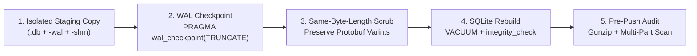

# Security Policy & Secret Redaction Architecture

`antigravity-chat-sync` is designed to archive real-world engineering conversations safely without exposing credentials or corrupting binary conversation trajectories.

> [!IMPORTANT]
> **Zero In-Place Modification:** Live files inside `~/.gemini/antigravity` are never modified during export. Every conversation database (including active `-wal` and `-shm` frames) is copied into an isolated `.tmp-sanitize/` staging directory before checkpointing, redaction, and compression.

---

## Supported Versions

| Version | Status | Security Updates |
| :--- | :---: | :--- |
| `1.x` (`main`) | Active | Supported |
| `< 1.0` | Deprecated | Not supported |

### Reporting a Vulnerability

If you discover a secret pattern bypass, binary corruption edge case, or security issue:

1. **Do not open a public issue** containing live token samples or sensitive payloads.
2. Use **GitHub Private Vulnerability Reporting** under the repository's **Security -> Advisories** tab to submit a confidential report with reproduction steps using synthetic dummy tokens.

---

## Threat Model

Archiving AI coding sessions to GitHub introduces two conflicting technical constraints:

| Risk | Root Cause | Consequence if Unaddressed |
| :--- | :--- | :--- |
| **Credential Exposure** | Prompts, `.env` inspections, and terminal outputs stored in chat history frequently contain live API keys, tokens, or database URLs. | Leaked production secrets and blocked pushes via GitHub Push Protection. |
| **Protobuf Wire Corruption** | `conversations/<id>.db` stores chat steps as serialized binary Protocol Buffers (`BLOB`) prefixed by base-128 varint byte lengths. | Naive variable-length string replacement (`<REDACTED>`) invalidates outer varint length prefixes and breaks conversation deserialization. |

---

## Sanitization Pipeline



### Why Naive String Replacement Corrupts `.db` Files

In Protocol Buffers (wire type `2`, length-delimited fields), every string and parent message embeds an explicit byte-length prefix:

```text
Original Wire Bytes (Valid):
[field_tag][varint_len = 192][ATATT3xFfGF0... (192 bytes)]

Naive Replacement (Corrupted — Outer Message Lengths Mismatch):
[field_tag][varint_len = 192][<REDACTED> (10 bytes)]  <-- Deserialization Fails

Same-Byte-Length Replacement (Valid — 100% Offset Integrity):
[field_tag][varint_len = 192][REDACTED_JIRA_TOKEN_XXXX... (192 bytes)]
```

### Defense-in-Depth Stages (`src/redact.ts` & `src/verify.ts`)

1. **WAL-Aware Staging:** Copies `<id>.db`, `<id>.db-wal`, and `<id>.db-shm` into `.tmp-sanitize/` and flushes all pending frames with `PRAGMA wal_checkpoint(TRUNCATE)`.
2. **Same-Byte-Length Binary Replacement:** Scans binary `Uint8Array` payloads in `latin1` byte space (preserving strict 1:1 byte indexing) and overwrites matched credentials with deterministic placeholders of the exact same byte length (`match[0].length`).
3. **Free-Page Purging (`VACUUM`):** Updating SQLite `BLOB` rows can leave older unreferenced B-tree overflow pages inside the database's free-page list, where raw binary scanners could still read them. Running `VACUUM` rebuilds the SQLite file from scratch, purging all historical page remnants while reducing `.db.gz` size.
4. **Structural & Leak Verification (`bun run verify`):**
   - Verifies `PRAGMA integrity_check === "ok"` on every sanitized SQLite file.
   - Decompresses every `.gz` archive — and reassembles split `.gz.part01` / `.part02` chunks in memory — scanning raw bytes against all secret rules before `git push` is permitted.

---

## Redacted Secret Categories

| Category / Provider | Detected Formats & Prefixes | Binary Strategy |
| :--- | :--- | :--- |
| **Atlassian / Jira** | `ATATT3x...` API tokens | Same-byte-length mask + `VACUUM` |
| **GitHub** | `ghp_...`, `gho_...`, `ghu_...`, `ghs_...`, `ghr_...`, `github_pat_...` | Same-byte-length mask + `VACUUM` |
| **Postman** | `PMAK-...` API keys | Same-byte-length mask + `VACUUM` |
| **Google Cloud / Gemini** | `AIza...` API keys & OAuth tokens | Same-byte-length mask + `VACUUM` |
| **OpenAI / Anthropic** | `sk-...`, `sk-proj-...`, `sk-ant-...` | Same-byte-length mask + `VACUUM` |
| **Slack** | `xoxb-...`, `xoxp-...`, `xoxa-...`, `xoxr-...` | Same-byte-length mask + `VACUUM` |
| **Stripe** | `sk_live_...`, `rk_live_...` | Same-byte-length mask + `VACUUM` |
| **AWS** | `AKIA...`, `ASIA...` access key IDs | Same-byte-length mask + `VACUUM` |
| **Cryptographic Keys** | `-----BEGIN ... PRIVATE KEY-----` PEM blocks | Same-byte-length mask + `VACUUM` |
| **Database Credentials** | `postgres://`, `mysql://`, `mongodb://`, `redis://` URI passwords | Password-segment mask + `VACUUM` |
| **JSON Web Tokens** | Three-part `eyJ...` signed JWTs | Same-byte-length mask + `VACUUM` |

---

## Security Best Practices for Archive Repositories

> [!TIP]
> - Always keep your **conversation archive repository** (`*-chats`) set to **Private** on GitHub, even with automated secret redaction enabled.
> - Run `bun run verify` whenever customizing redaction patterns in `src/redact.ts` to confirm zero false negatives across both single and multi-part compressed archives.
